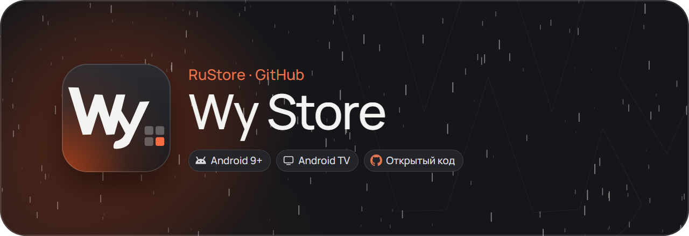
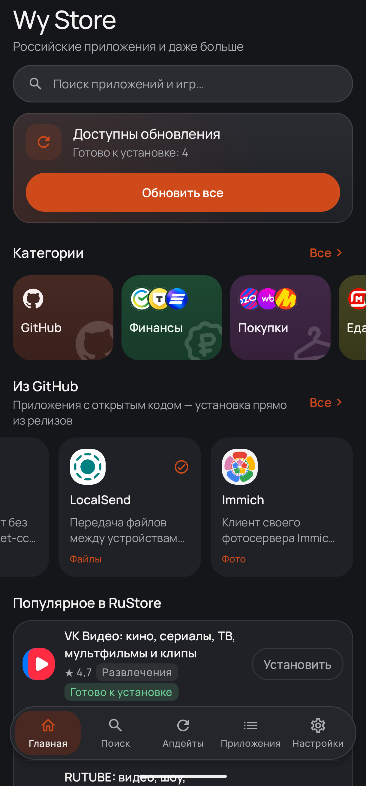
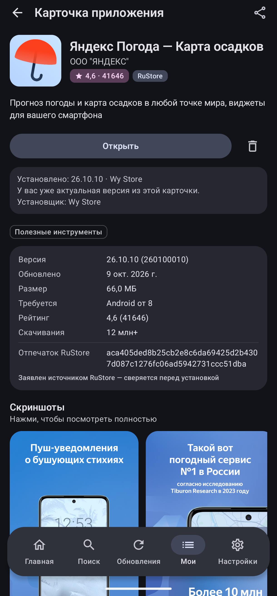
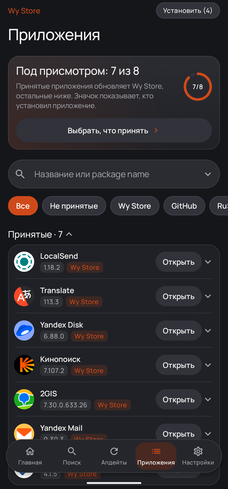
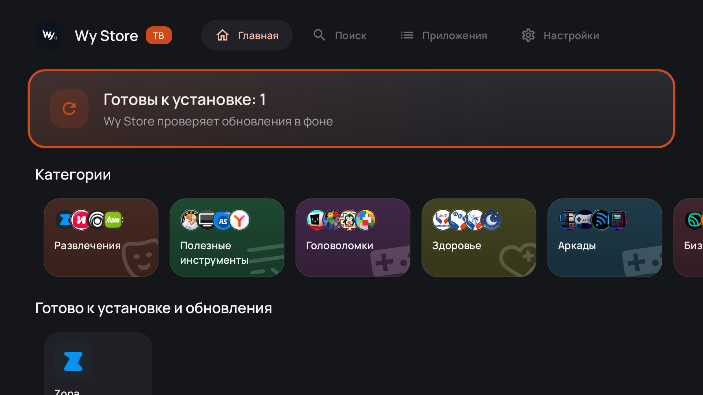
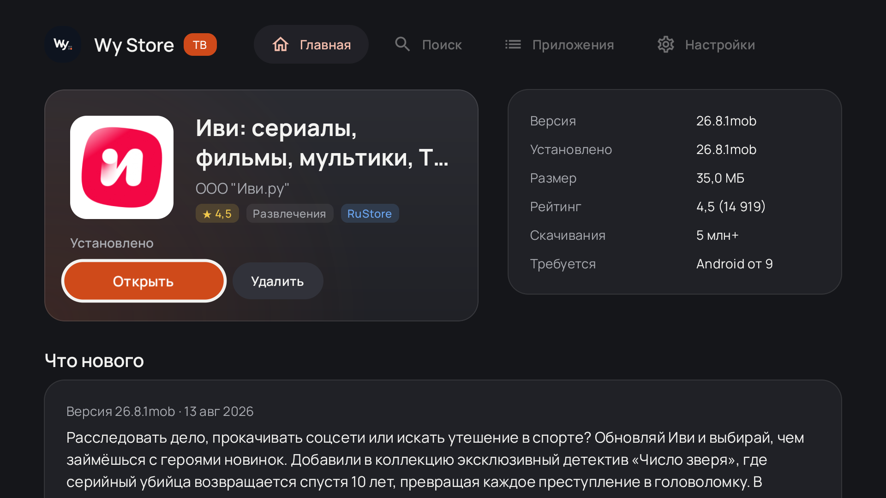
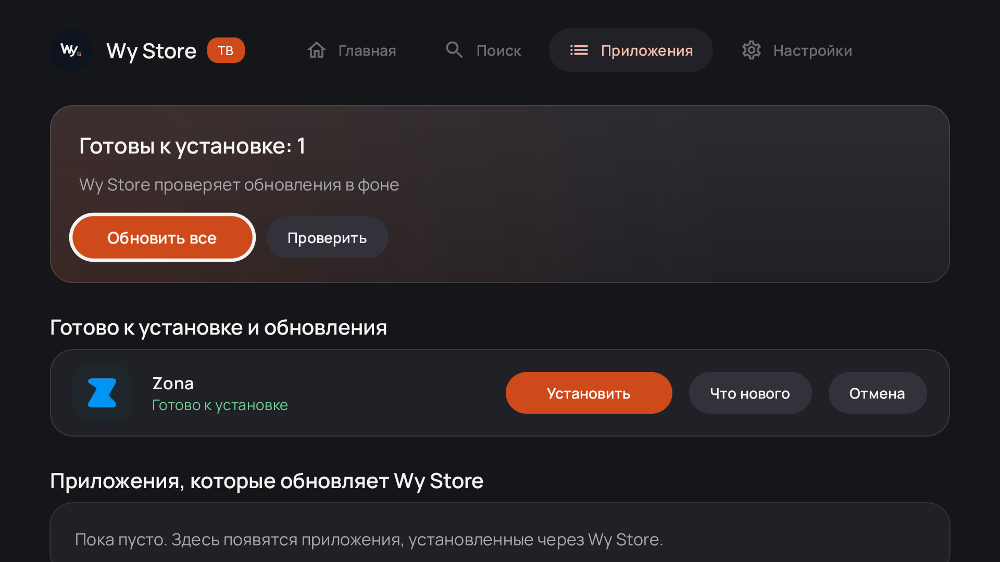

<div align="center">



**Альтернатива RuStore без слежки и рекламы**

[](https://github.com/wyrtensi/wystore/releases/latest/download/wystore.apk)
[](https://github.com/wyrtensi/wystore/releases)

[](https://github.com/wyrtensi/wystore/releases/latest)
[](https://github.com/wyrtensi/wystore/actions/workflows/build.yml)
[](#требования)
[](https://t.me/+_YytpJdDHgQ4OTYy)
[](LICENSE)

[Сайт проекта](https://wystore.ru)

**Русский** · [English](README.en.md) · [Українська](README.uk.md) · [Беларуская](README.be.md) · [Қазақша](README.kk.md) · [Oʻzbekcha](README.uz.md) · [Latviešu](README.lv.md) · [简体中文](README.zh.md)

[Релизы](https://github.com/wyrtensi/wystore/releases) · [История изменений](CHANGELOG.md) · [Конфиденциальность](PRIVACY.md) · [Безопасность](SECURITY.md) · [Заявление о проекте](DISCLAIMER.md) · [Лицензия](LICENSE)

</div>

Wy Store — клиент каталога RuStore для Android. Он показывает те же приложения, что и магазин
приложений RuStore, но скачивает и ставит их сам, через системный установщик, и не требует ни
аккаунта, ни установленного клиента RuStore. Вторым источником идут релизы с GitHub — так в списке
оказывается и то, чего в RuStore нет.

У проекта нет своего сервера, аккаунтов, аналитики и рекламы. Приложение обращается только к
`rustore.ru`, `github.com` и хранилищам, с которых эти сервисы сами раздают файлы.

Wy Store не связан с RuStore и не действует от его имени: RuStore здесь — источник данных.
Подробности — в [DISCLAIMER.md](DISCLAIMER.md).

| Главная | Страница приложения | Приложения |
|---|---|---|
|  |  |  |

[Разбор по экранам](https://telegra.ph/Wy-Store-magazin-prilozhenij-kotoryj-ne-prosit-vojti-v-akkaunt-09-09) — как приложение выглядит в работе и что в нём работает не всегда.

## Возможности

- **Два источника в одном списке.** Карточки RuStore и релизы отобранных проектов с GitHub идут
  рядом в поиске, на главной и в разделах; у каждой подписан источник. Свой публичный репозиторий
  добавляется ссылкой.
- **Разделы каталога.** Разделы RuStore — плитками на главной и отдельным экраном со всеми
  разделами. В настройках можно переключиться на собственный набор разделов Wy Store.
- **Проверка APK до установки.** Имя пакета, versionCode, полнота комплекта split-APK и сертификат
  подписи сверяются перед тем, как файл уйдёт в установщик. Несовпадение — отказ с указанием
  причины.
- **Обновления в фоне.** Проверка по расписанию и автозагрузка найденного. Установка без диалога
  возможна на Android 12 и новее для того, что Wy Store поставил сам, — но не гарантирована:
  подробности ниже.
- **Очередь загрузок.** Хранится в базе, переживает перезагрузку и обрыв сети, продолжает загрузку
  с прерванного места по HTTP Range. Если сеть пропала, загрузка сразу встаёт в очередь и
  докачивается, когда сеть вернётся. Из очереди и из списка «Апдейты» можно открыть страницу
  приложения, а кнопка «Что нового» показывает, что изменилось в предлагаемой версии, не уходя со
  списка.
- **Честные сообщения.** Без сети каталог и поиск пишут «Нет связи с сервером» и предлагают
  повторить, а не «Ничего не найдено». Приложению, которому нужен более новый Android, «Установить»
  сразу говорит, какой именно.
- **Отзывы и оценки.** Для приложений RuStore — рейтинг, разбор по числу звёзд и фильтр по оценке.
- **Приложения.** Вкладка со всем, что стоит на телефоне: принятые Wy Store сверху, остальные ниже,
  у каждого значок установщика. Фильтры по источнику и «Не принятые», несколько приложений
  принимаются разом; обновление и удаление из одного списка.
- **Резервная копия.** Экспорт и импорт настроек, принятых приложений и добавленных репозиториев
  одним JSON-файлом.
- **Экономия трафика.** Режим «только Wi-Fi» для фоновых загрузок; при ручной загрузке через
  мобильный интернет приложение спрашивает подтверждение.
- **Android TV.** Тот же APK работает на Android TV и Google TV, со своим интерфейсом под пульт и
  каталогом RuStore для телевизоров. Подробности — в разделе [Android TV](#android-tv).
- **Root по желанию.** С выданным root первая установка, обновление и удаление проходят без окон
  Android, в том числе в фоне. По умолчанию выключено; подробности — в разделе [Root](#root).
- **Установка через adb для агентов и скриптов.** Компьютер передаёт Wy Store список пакетов,
  магазин скачивает и проверяет их, а ставятся они без окон на телефоне и без root; установщиком
  записывается Wy Store. Подробности — в разделе
  [Установка через adb](#установка-через-adb-без-root) ниже.
- **Интерфейс.** Русский, English, Українська, Беларуская, Қазақша, Oʻzbekcha, Latviešu, 简体中文.
  Оформление Wy Hub на телефоне и телевизоре: тёмная тема графитовая, а не чёрная, есть светлая и
  системная; шрифт Manrope (на казахском, узбекском и китайском — системный, в котором есть все
  буквы); у каждого состояния свой цвет: зелёный — готово, жёлтый — пауза, голубой — ждёт вас,
  красный — ошибка.
- **Цвет акцента.** Один из девяти в **Настройки → Внешний вид**; в этом цвете кнопки, открытая
  вкладка и прогресс. Вместо него можно включить цвета обоев (Material You, Android 12 и новее) —
  тогда акцент выбирают они.

## Android TV

| Главная | Страница приложения | Приложения |
|---|---|---|
|  |  |  |

Отдельной сборки нет: тот же APK ставится на Android TV и Google TV с Android 9 и новее и
появляется в лаунчере телевизора. Тип устройства определяется сам; если приставка определилась
как телефон, его можно выбрать вручную в **Настройки → Внешний вид → Тип устройства** (авто,
телефон, телевизор).

- **Управление с пульта.** Меню вкладками сверху — Главная, Поиск, Приложения, Настройки;
  рядом с названием Wy Store стоит метка «ТВ». Кнопка «Назад» ведёт наружу: из содержимого в меню,
  из меню на Главную, с Главной — выход. После возврата фокус стоит на той карточке, которую
  открывали.
- **Главная.** Карточка обновлений, плитки разделов, ряды по разделам и ряд «Из GitHub». Уведомлений
  на телевизоре нет, поэтому приложения, готовые к установке или обновлению, собраны в ряд вверху
  Главной.
- **Страница приложения.** Скриншоты для телевизора, отзывы и «Что нового»; «Что нового» есть и у
  приложений, которые ждут загрузки или установки, на вкладке «Приложения».
- **Оформление.** То же Wy Hub, что на телефоне, с тем же выбором цвета акцента: у плиток разделов
  значки, ряды карточек идут до краёв экрана, а названия на карточках занимают до трёх строк.
- **Поиск.** Текстом или голосом. Результаты — из ТВ-каталога, а если включён каталог для
  телефона, то и из всего RuStore, плюс GitHub.
- **Каталог.** У RuStore отдельный каталог для телевизоров. Настройка **«Каталог на телевизоре»**:
  «Для телевизора» (по умолчанию), «Для телефона» или «Оба». В режиме «Оба» приложения для телефона
  идут своими рядами и помечены «Для телефона»: многие из них не рассчитаны на пульт. Приложения,
  установленные из любого каталога, продолжают обновляться при любом выборе.
- **GitHub.** Каталог GitHub есть и на телефоне, и на телевизоре; выключается в
  **Настройки → Источники приложений**.

## Установка

1. Скачайте `wystore-<версия>.apk` из
   [последнего релиза](https://github.com/wyrtensi/wystore/releases/latest).
2. Откройте файл. Android один раз спросит разрешение на установку из этого источника.
3. Дальше Wy Store обновляет себя сам — он следит за релизами в этом репозитории.

В каждом релизе два файла, `wystore-<версия>.apk` и `wystore.apk`. Это одна и та же сборка с одной
подписью: второй нужен для постоянной ссылки `releases/latest/download/wystore.apk`.

APK подписан постоянным ключом, отпечаток которого CI печатает при каждой публикации. Проверить
скачанный файл:

```bash
apksigner verify --print-certs wystore-<версия>.apk
```

### На телевизор

Скачайте APK на телевизор файловым менеджером или поставьте с компьютера:

```bash
adb install wystore.apk
```

При установке с телевизора Android один раз спросит разрешение на установку неизвестных приложений.

### Переход на 0.2.0 с более ранних версий

В версии 0.2.0 сменился идентификатор приложения: `dev.wystore` → `app.wystore`. Для Android это
другое приложение, поэтому обновление придётся поставить вручную, один раз:

1. В старом Wy Store: **Настройки → Резервная копия и перенос → Экспорт**, сохраните файл.
2. Установите новый APK.
3. В новом Wy Store: **Настройки → Резервная копия и перенос → Импорт**, выберите этот файл.
   Перенесутся настройки, принятые приложения и добавленные репозитории GitHub.
4. Удалите старую версию, иначе два магазина будут проверять одни и те же приложения.
5. Выдайте новому приложению исключение из оптимизации батареи и подтвердите передачу обновлений
   при первом обновлении: оба разрешения привязаны к идентификатору и не переносятся.

Дальше самообновление работает как раньше.

## Как работают обновления

Найти и скачать обновление приложение умеет само и всегда. А вот поставить его без единого нажатия
получается не везде, и это стоит объяснить точно, потому что подтверждений на пути два и они
независимы.

### Первое: системный установщик Android

Начиная с Android 12 система разрешает обновлять приложение без своего окна тому, кто это
приложение установил. Условий четыре, и они выполняются или нет целиком:

- это обновление, а не первая установка;
- Wy Store числится установщиком этого приложения;
- обновляемое приложение собрано под API 33 (Android 13) или новее;
- у приложения нет другого владельца обновлений — например, Google Play.

Сходится — системное окно не показывается вовсе. На Android 9, 10 и 11 этого не может ни один
сторонний магазин, включая RuStore. Google Play может на любой версии, но не потому, что знает
секрет: он системное привилегированное приложение и держит разрешение `INSTALL_PACKAGES`, которое
обычному приложению не выдаётся никогда.

### Второе: Google Play Protect

Если на телефоне есть сервисы Google, Play Protect проверяет каждый APK, которого раньше не видел,
и показывает **своё** окно — «отправить приложение на проверку» — поверх любой тихой установки. Оно
ждёт нажатия сколько угодно; пока на него не ответят, установки не будет.

Запоминает Play Protect файл, а не приложение: тот же самый APK во второй раз проходит молча.
Отсюда практический вывод: свежая сборка малоизвестного приложения почти наверняка попросит
подтверждение у того, кто получит её одним из первых, а популярное приложение, которое Google уже
видел, — нет. На телефонах без сервисов Google этого шага нет вообще.

Это не рассуждение, а то, что видно на устройстве. Проверено на Android 16: системное окно при
обновлении не появлялось ни разу, окно Play Protect появлялось на каждый новый файл и не появлялось
на уже проверенный.

### Итог без прикрас

- **С root** — без окон Android ставится всё, включая первую установку: установка идёт через `pm`
  от root, мимо диалога системного установщика. На устройствах с сервисами Google Play Protect
  может всё равно проверить файл, которого раньше не видел. По умолчанию root выключен.
- **Без root** — как повезёт. Чаще всего работает, но гарантии нет: последнее слово за Play Protect,
  и оно зависит от того, видел ли Google этот конкретный файл.

Скачивание при этом происходит в любом случае и без вопросов; нажатие, если оно понадобится, — это
подтверждение установки, а не загрузка заново.

### Настройки цепочки

Все три включены по умолчанию:

| Настройка | Что делает |
|---|---|
| Скачивать обновления сразу | Найденное обновление начинает качаться само. Фоновая проверка при этом уважает режим «только Wi-Fi». |
| Устанавливать сразу после скачивания | Скачанное уходит в установку без дополнительного нажатия. |
| Обновлять без вопросов | Просить систему пропустить её диалог там, где она это разрешает. |

### Root

Root не обязателен и по умолчанию выключен. Чтобы включить: **Настройки → Центр разрешений →
«Проверить Root»**. Менеджер root (Magisk, KernelSU и другие) покажет свой запрос — выдайте доступ
Wy Store (`app.wystore`). Карточка покажет «Доступен», при отказе — «Не выдан». `su` ищется там, где
его держит устройство: в `PATH`, `/system/bin`, `/system/xbin`, `/sbin`, `/su/bin`,
`/debug_ramdisk`; root считается выданным, только если `id` сообщает uid 0. Для KernelSU есть
отдельная инструкция — [KERNELSU_ROOT_RU.md](KERNELSU_ROOT_RU.md).

Переключатели лежат в настройках, в группе «Фоновые обновления», и работают, только пока root
выдан:

| Настройка | Что делает |
|---|---|
| Тихая root-установка | Первые установки и обновления, из RuStore и с GitHub, идут через `pm` от root без окна Android. Wy Store записывается установщиком приложения, а на Android 14 и новее — и владельцем обновлений, так же как при установке через диалог. Приложение числится установленным Wy Store и получает обновления как обычно. |
| Тихое root-удаление | Выключено по умолчанию. Кнопка «Удалить» удаляет приложение через root сразу, без подтверждения, вместе с его данными. Если в этот момент root не выдан, открывается обычное окно удаления Android. |
| Скачивать обновления в фоне (root) | Фоновая проверка по расписанию скачивает обновления, даже когда «Скачивать обновления сразу» выключено. |

С root фоновая проверка сама находит обновление, скачивает и ставит его через root, пока Wy Store
закрыт, без единого нажатия.

Если root отозвали, «Проверить Root» покажет «Не выдан», тихая установка выключится, и установка
вернётся к окну Android.

Когда вызывается `su` — менеджер root может спрашивать каждый раз, если доступ выдан не навсегда:

- по кнопке «Проверить Root»;
- при запуске, если включены тихая установка или тихое удаление;
- в фоновой проверке — только когда «Скачивать обновления сразу» выключено, а «Скачивать обновления
  в фоне (root)» включено;
- при установке и удалении, если включён соответствующий переключатель.

Каталог, поиск и страницы приложений root не запрашивают никогда.

### Установка через adb (без root)

Компьютер с adb может передать Wy Store список приложений: магазин скачает их из RuStore и проверит
так же, как свои, а поставит их сам компьютер — без окон на телефоне и без root. Установщиком
приложений записывается Wy Store, они попадают во вкладку «Приложения» и дальше обновляются из
магазина. Это удобно для агентов и скриптов, которые настраивают телефон.

```bash
python tools/wystore_adb_install.py ru.ozon.app.android ru.nspk.mirpay
```

Скрипт открывает Wy Store, ставит пакеты в очередь, ждёт загрузки, устанавливает каждый через
сессию `pm` (`pm install-create -i app.wystore`) и просит Wy Store подтвердить установку. Подтверждение
принимается, только если на телефоне оказалась та версия и та подпись, что были проверены при
загрузке. Код возврата 0 — всё установлено.

Без скрипта то же самое делается командами `content call` к `content://app.wystore.agent`:

| Метод | Аргумент | Ответ |
|---|---|---|
| `install` | `pkg1,pkg2,…` (до 50) | id строк очереди, отклонённые имена |
| `status` | id через запятую или ничего | состояние, ошибка, версия и ссылки на проверенные APK |
| `installed` | id | подтверждение установки: Wy Store принимает приложение как своё |
| `cancel` | id | отмена загрузки |

Готовые APK читаются как `content://app.wystore.agent/artifact/<id>/<n>`, например
`content read --uri … | pm install-write -S <размер> <сессия> <n>.apk -`. Интерфейс отвечает только
оболочке adb (и root): другие приложения на телефоне вызвать его не могут.

На Xiaomi для установки по adb нужно включить в «Для разработчиков» пункт «Отладка по USB
(настройки безопасности)», иначе Android ответит `INSTALL_FAILED_USER_RESTRICTED`.

### Ещё границы

- Первая установка приложения подтверждается всегда — кроме режима с root и установки через adb.
- Приложение, установленное другим магазином, обновляется с подтверждением. Передать его обновления
  Wy Store можно кнопкой на карточке: приложение переустанавливается поверх, один раз с
  подтверждением, после чего владельцем установки становится Wy Store.
- Если версия в каталоге ниже установленной или приложение подписано другим ключом, поставить поверх
  нельзя вообще ничем — Android откажет. Тогда приложение предлагает удалить и поставить заново;
  данные приложения при этом, как правило, теряются.
- Приложения из Google Play по умолчанию не трогаются, пока это не включено для конкретного
  приложения.

## Безопасность

- Перед установкой проверяются имя пакета, versionCode, наличие ровно одного базового APK в
  комплекте и сертификат подписи. Для уже установленного приложения подпись сверяется с
  установленной копией, а versionCode должен расти.
- Загрузки идут только с разрешённых хостов, перенаправления разбираются явно.
- Скачанные APK лежат в приватном каталоге приложения и удаляются по заданным сроку хранения и
  лимиту места.
- Тихая установка не ослабляет проверки: APK с чужой подписью отклоняется и в этом режиме.

Wy Store проверяет доставку, а не содержимое приложений. Что делает установленная программа —
вопрос к её разработчику, и источник назван на каждой карточке.

Нашли дыру — [SECURITY.md](SECURITY.md): что считается уязвимостью, куда писать и почему не в
публичную задачу.

## Приватность

- Ни аккаунта, ни регистрации, ни входа.
- Нет аналитики, рекламных SDK и краш-репортёров.
- У проекта нет сервера: запросы идут напрямую к RuStore и GitHub, без посредников.
- Клиент представляется как `WyStore/<версия>` и не создаёт `User-Token` RuStore.
- Всё, что приложение хранит, остаётся на устройстве. Резервная копия создаётся по вашей команде и
  сохраняется туда, куда вы укажете.

Полный текст — в [PRIVACY.md](PRIVACY.md).

## Разрешения

| Разрешение | Зачем |
|---|---|
| `INTERNET`, `ACCESS_NETWORK_STATE` | Загрузка каталога и APK, проверка типа сети для режима «только Wi-Fi» |
| `REQUEST_INSTALL_PACKAGES` | Установка скачанных APK |
| `UPDATE_PACKAGES_WITHOUT_USER_ACTION`, `ENFORCE_UPDATE_OWNERSHIP` | Обновление без диалога того, что установил сам Wy Store |
| `REQUEST_DELETE_PACKAGES` | Удаление приложения из списка «Приложения» |
| `QUERY_ALL_PACKAGES` | Сопоставление каталога с установленным: версии, статусы, поиск обновлений |
| `POST_NOTIFICATIONS` | Уведомления о найденных обновлениях и ходе загрузки |
| `FOREGROUND_SERVICE`, `FOREGROUND_SERVICE_DATA_SYNC`, `RUN_USER_INITIATED_JOBS` | Загрузка, которую система не убьёт на середине |
| `RECEIVE_BOOT_COMPLETED` | Восстановление расписания проверок после перезагрузки |
| `REQUEST_IGNORE_BATTERY_OPTIMIZATIONS` | Запрашивается по желанию: без исключения фоновые проверки приходят не по расписанию |

## Источник данных и его ограничения

Приложение читает публичные веб-эндпоинты RuStore — то же, что отдаёт сайт браузеру. Это не
поддерживаемое клиентское API, и оно может измениться без предупреждения. Интеграция изолирована в
`RuStoreSource`, поэтому изменение на стороне источника проявляется как ошибка формата, а не как
испорченные данные в каталоге.

Поддерживаются бесплатные приложения. Платное, покупки внутри и всё, что требует авторизации в
RuStore, недоступны.

Разбор эндпоинтов, причина HTTP 419 и поведение запасного варианта —
в [docs/RUSTORE_API_COMPATIBILITY_RU.md](docs/RUSTORE_API_COMPATIBILITY_RU.md).

## Требования

- **Android 9.0 (API 28)** или новее. Это требование самого Wy Store; приложениям из каталога
  нередко нужна версия новее, и она указана на странице каждого из них — до загрузки, а не после.
  Нажатие «Установить» на приложении, которому нужен более новый Android, сразу говорит, какой.
- Разрешение на установку неизвестных приложений: Android запросит его при первой установке.
- Root не обязателен. Без него установка без подтверждения возможна только для обновлений, только
  на Android 12 и новее и только пока её не остановит Play Protect. С root без окон Android
  ставится всё, включая первую установку, а удаление по желанию проходит без подтверждения.
  Подробности — в разделе «Как работают обновления».
- **Android TV и Google TV** на Android 9 и новее — тем же APK. Уведомлений на телевизоре нет,
  готовое к установке показывается на Главной.
- Архитектура и плотность экрана определяются автоматически: выбирается подходящий комплект APK.

## Вопросы

**Нужен ли аккаунт RuStore?** Нет. Приложение его не заводит и не умеет им пользоваться.

**Заменяет ли Wy Store клиент RuStore?** Для установки и обновления бесплатных приложений — да.
Платный контент и покупки остаются за официальным клиентом.

**Что будет с приложениями, если удалить Wy Store?** Ничего: они установлены системой и останутся
на месте. Перестанут приходить только автоматические обновления.

**Зачем доступ к списку установленных программ?** Чтобы показывать в каталоге реальный статус:
установлено, доступно обновление, версия совпадает. Список никуда не отправляется.

**Можно ли добавить свой репозиторий с GitHub?** Да, ссылкой в разделе GitHub. Релиз выбирается по
правилам: nightly-теги и релизы без пригодного APK пропускаются.

## Сборка

Нужны JDK 17 или новее и Android SDK Platform 36.

```bash
./gradlew :app:assembleDebug
```

APK появится в `app/build/outputs/apk/debug/app-debug.apk`.

Тесты:

```bash
./gradlew :app:testDebugUnitTest
```

Инструментальные тесты, с подключённым устройством или эмулятором:

```bash
./gradlew :app:connectedDebugAndroidTest
```

### Подпись релиза

Проверка подписи распространяется и на сам Wy Store, поэтому собранная локально сборка не обновится
опубликованным релизом, и наоборот: для Android это разные приложения.

Создать ключ (пароль `keytool` спросит сам, в команде его писать не нужно):

```bash
keytool -genkeypair -v -keystore outputs/wystore-release.jks -alias wystore -keyalg RSA -keysize 4096 -validity 10000
```

Данные для подписи берутся из `keystore.properties` в корне репозитория (файл в `.gitignore`,
шаблон — [keystore.properties.example](keystore.properties.example)) или из переменных окружения
`WYSTORE_KEYSTORE`, `WYSTORE_KEYSTORE_PASSWORD`, `WYSTORE_KEY_ALIAS`, `WYSTORE_KEY_PASSWORD`.
Нужны все четыре: при нехватке любого release-сборка остаётся неподписанной, а не подписывается
debug-ключом молча.

### Публикация

Сначала запись в [CHANGELOG.md](CHANGELOG.md) под номером новой версии, потом тег. Текст релиза на
GitHub берётся из этого раздела, и тег без записи роняет сборку.

```bash
git tag v<версия> && git push origin v<версия>
```

Релиз собирает CI по тегу — [.github/workflows/release.yml](.github/workflows/release.yml). В
секретах репозитория должны лежать `WYSTORE_KEYSTORE_BASE64` (файл ключа в base64),
`WYSTORE_KEYSTORE_PASSWORD`, `WYSTORE_KEY_ALIAS` и `WYSTORE_KEY_PASSWORD`. Workflow проверяет, что
APK подписан, и падает, если нет.

Ключ подписи в секретах CI доступен любому, кто может изменить workflow в этом репозитории. Если
это неприемлемо, собирайте релиз локально и загружайте APK вручную.

## Структура проекта

| Путь | Что там |
|---|---|
| `app/src/main/java/dev/wystore/data` | Источники, каталог, модели, проверка APK |
| `app/src/main/java/dev/wystore/updates` | Очередь загрузок, установка, планировщики |
| `app/src/main/java/dev/wystore/background` | Воркеры, политика уведомлений и батареи |
| `app/src/main/java/dev/wystore/selfupdate` | Обновление самого Wy Store |
| `app/src/main/java/dev/wystore/localization` | Перевод кодов ошибок в текст |
| `app/src/main/java/dev/wystore/ui` | Экраны на Compose, тема, общие компоненты |
| `app/src/test` | Юнит-тесты, включая HTML-фикстуры, снятые с источника |
| `app/src/androidTest` | Инструментальные тесты |

Каталог исходников остался `dev/wystore`: это `namespace` пакета Java. Идентификатор приложения для
Android задаётся отдельно и равен `app.wystore`.

## Обратная связь

Ошибки и предложения — в [Issues](https://github.com/wyrtensi/wystore/issues). Обсуждение —
в [Telegram-чате](https://t.me/+_YytpJdDHgQ4OTYy).

К сообщению об ошибке помогает приложить отчёт: **Настройки → О приложении → Отчёт для сообщения об
ошибке**. В нём версия Android, модель устройства, состояние root и разрешений, очередь и последние
сбои — без аккаунтов, ссылок и путей к файлам.

## Лицензия

MIT, см. [LICENSE](LICENSE).
