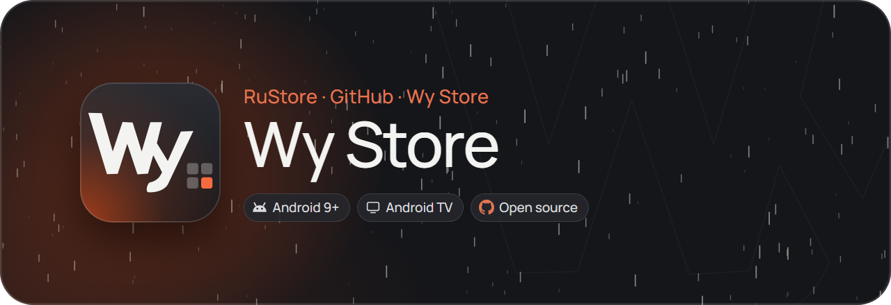
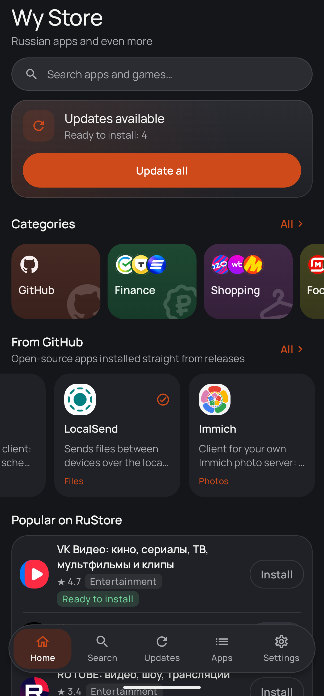
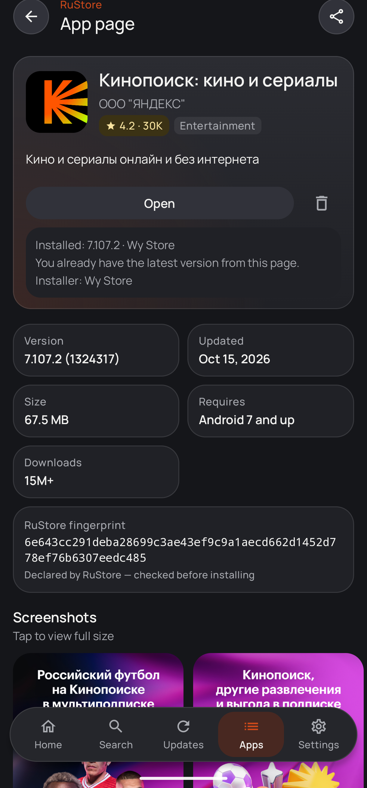
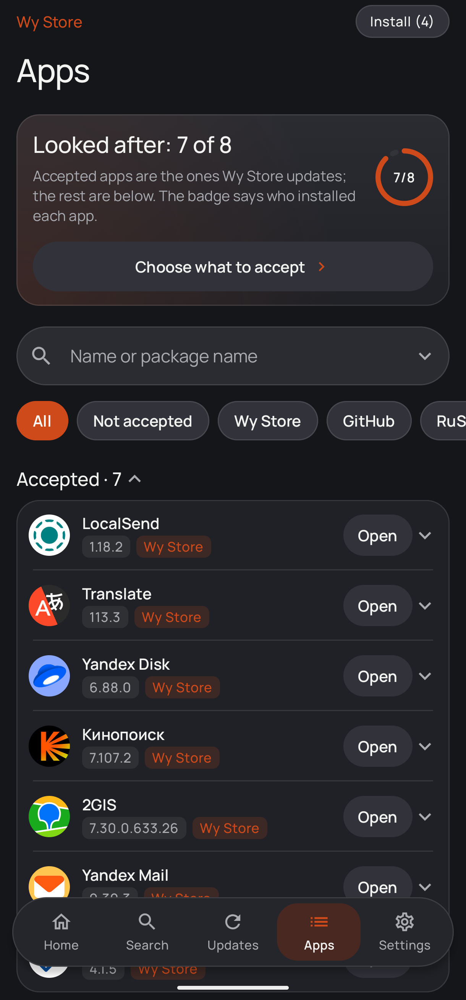
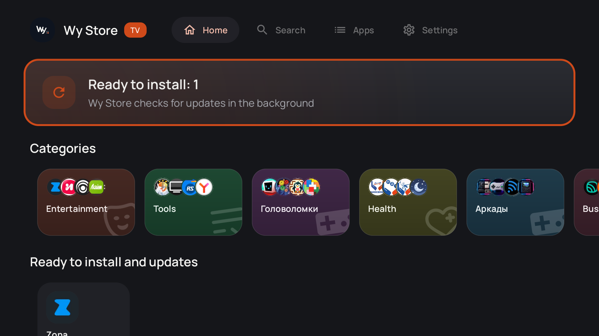
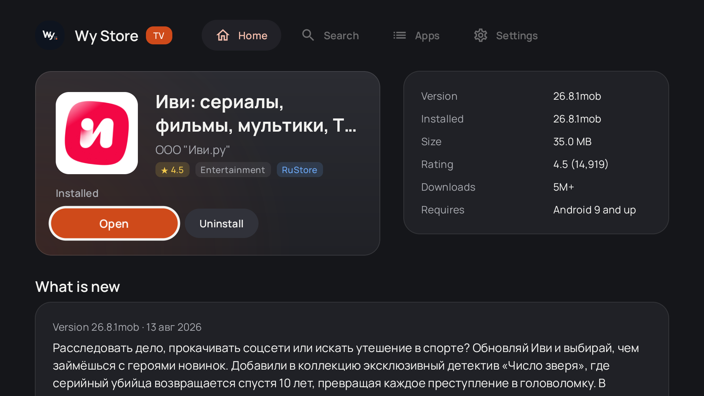
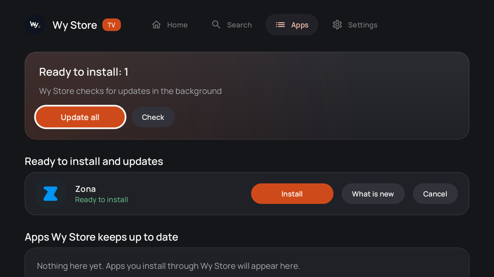

**Каталог апликација за Android без огласа и праћења**

[Преузми APK](https://github.com/wyrtensi/wystore/releases/latest/download/wystore.apk) · [Издања](https://github.com/wyrtensi/wystore/releases) · [Историја измена](CHANGELOG.md) · [Приватност](PRIVACY.md) · [Безбедност](SECURITY.md) · [Лиценца](LICENSE)

[Русский](README.md) · [English](README.en.md) · [Українська](README.uk.md) · [Беларуская](README.be.md) · [Қазақша](README.kk.md) · [Oʻzbekcha](README.uz.md) · [Latviešu](README.lv.md) · [简体中文](README.zh.md) · **Српски**

Wy Store је Android клијент каталога апликација. Преузима и инсталира апликације преко системског инсталатера, без налога или инсталираног RuStore клијента. Пројекат није повезан са RuStore-ом; погледајте [изјаву о пројекту](DISCLAIMER.md).

Постоје три извора: RuStore, GitHub издања и [Wy Store Library](https://github.com/wyrtensi/wystore-library). Индекс Library-ја је статички JSON на GitHub-у; приступни подаци узводног сервиса нису у клијенту и корисник не мора да се пријави на Google. Нема аналитике ни огласа.

**Неке апликације недоступне или блокиране у руском Google Play-у могу да се преузму и инсталирају преко [Wy Store Library](https://github.com/wyrtensi/wystore-library), без пријаве на Google.**

| Почетна | Страница апликације | Апликације |
|---|---|---|
|  |  |  |

## Могућности

- **Три извора у једној листи.** Уноси са истим именом пакета спајају се у једну картицу са ознакама и избором извора. Јавни GitHub репозиторијум може да се дода везом.
- **Каталог.** Претраживање, одељци и оцене за апликације из RuStore-а. Library има обичну категорију страних апликација; уредништво може да изузме појединачну апликацију из ње.
- **Провера пре инсталације.** Верзија се проверава пре преузимања, а преузима се цео изабрани скуп split APK датотека. Пре инсталације проверавају се интегритет, пакет и потпис. Компатибилан потпис омогућава ажурирање; у супротном су за уклањање и поновну инсталацију потребни изричита сагласност и провера. Подаци апликације могу да се изгубе.
- **Ажурирања и преузимања.** Провере по распореду, ред за преузимање који наставља прекинути пренос и опција за коришћење само Wi-Fi мреже. Системски инсталатер може да тражи потврду; доступна је и опциона инсталација са root приступом.
- **Преузимање управљања.** Инсталиране апликације могу да се предају Wy Store-у. Ако Google Play преузме ажурирање, провере се паузирају; за сваку апликацију могу да се наставе уз изричиту сагласност.
- **Резервна копија.** Извоз и увоз подешавања, преузетих апликација и додатих репозиторијума у JSON датотеци.
- **Android TV.** Исти APK има интерфејс за даљински управљач и RuStore каталог за телевизоре. Претрага обухвата телевизијски каталог RuStore-а, GitHub и Wy Store Library, као и цео RuStore када је укључен каталог за телефон.
- **ADB.** Скрипта `tools/wystore_adb_install.py` омогућава инсталацију преко рачунара; упутство за извоз дијагностике је у [docs/adb-diagnostics.md](docs/adb-diagnostics.md).

## Android TV

| Почетна | Страница апликације | Апликације |
|---|---|---|
|  |  |  |

## Инсталација и захтеви

Потребан је Android 9 или новији. Преузмите APK са [странице издања](https://github.com/wyrtensi/wystore/releases), отворите датотеку и дозволите инсталирање из тог извора када Android то затражи. Исти APK ради на Android TV-у и Google TV-у. Поједине апликације могу имати додатне захтеве и зависности.

## Приватност и безбедност

Захтеви се шаљу RuStore-у, GitHub-у, Wy Store Library-ју и складиштима датотека. Клијент не прави RuStore налог, не захтева Google пријаву и не садржи приступне податке узводног сервиса Library-ја. Подешавања се чувају на уређају; резервну копију правите по жељи. Више у [PRIVACY.md](PRIVACY.md).

Провера испоруке не гарантује безбедност саме апликације. За пријаву рањивости видите [SECURITY.md](SECURITY.md). RuStore јавни интерфејси могу да се промене без најаве; плаћене апликације и функције које захтевају RuStore пријаву нису подржане. Детаљи су у [опису компатибилности](docs/RUSTORE_API_COMPATIBILITY_RU.md).

## Изградња и повратне информације

За изградњу из изворног кода и потписивање издања погледајте [English README](README.en.md#building). Пријаве грешака и предлози су добродошли у [GitHub Issues](https://github.com/wyrtensi/wystore/issues).

## Лиценца

[MIT](LICENSE).
